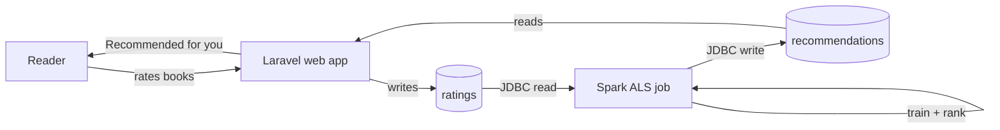

# Book Recommender: Spark ALS job

[](https://github.com/muhammedts/Recommendation-system-ALS-with-JDBC/actions/workflows/ci.yml)


A batch job that learns readers' tastes from their book ratings and writes a personalised
top-N reading list for every user back to the database.

It trains a collaborative-filtering model with **Apache Spark MLlib's ALS** (Alternating Least Squares)
on a `ratings` table over JDBC, checks the model on a held-out split, and fills a `recommendations` table
that the web app reads.

This is the machine-learning half of **Readit**. The other half is the Laravel web app where people browse,
rate and review books:
[Books-recommendation-system-with-sample-UI](https://github.com/muhammedts/Books-recommendation-system-with-sample-UI).

## How it works



1. **Load** `user_id, book_id, rating` from the `ratings` table and drop incomplete rows.
2. **Evaluate**: train on 80% of the ratings and report RMSE on the other 20%, so every run logs how good the model is.
3. **Train** a final model on all ratings.
4. **Recommend**: for each user, score candidate books, **remove the books they already rated**,
   and keep the top N in rank order.
5. **Write**: truncate and refill `recommendations` (`user_id, book_id, rank, score, generated_at`).
   Truncating instead of dropping keeps the keys and indexes that the web app's migrations created.

Run it once, for example from cron or a scheduler, or set `INTERVAL_MINUTES` to keep it running.
In scheduled mode a failed run is logged and the job tries again on the next interval.

## Quick start

### With Docker Compose (whole stack)

The web app repo has a `compose.yaml` that starts MySQL, the web app and this job together.
See its README.

### With Docker (job only)

```bash
docker build -t book-recommender-als .
docker run --rm \
  -e DB_URL=jdbc:mysql://host.docker.internal:3306/books \
  -e DB_USER=root -e DB_PASSWORD=secret \
  book-recommender-als
```

### With Maven (no Spark install needed)

Requires JDK 17 and Maven 3.9+. Point the job at a MySQL database that has the tables from
[`sql/schema.sql`](sql/schema.sql), or the ones the web app's migrations create:

```bash
export DB_URL=jdbc:mysql://localhost:3306/books DB_USER=root DB_PASSWORD=secret
mvn -Plocal compile exec:java
```

The `local` profile puts Spark on the classpath. Without it, Spark is `provided` and comes from `spark-submit`.

### On a Spark cluster

```bash
mvn package            # builds target/book-recommender-als-2.0.0.jar and copies the JDBC driver to target/lib
spark-submit \
  --class io.github.muhammedts.recommender.RecommenderJob \
  --jars "$(ls target/lib/*.jar | paste -sd, -)" \
  target/book-recommender-als-2.0.0.jar
```

## Configuration

All settings are environment variables, and all of them are optional. See [`.env.example`](.env.example).

| Variable | Default | Meaning |
| --- | --- | --- |
| `DB_URL` | `jdbc:mysql://localhost:3306/books` | JDBC URL of the app database |
| `DB_USER` / `DB_PASSWORD` | `root` / *(empty)* | Database credentials |
| `RATINGS_TABLE` | `ratings` | Table with `user_id, book_id, rating` |
| `RECOMMENDATIONS_TABLE` | `recommendations` | Table the job refills |
| `TOP_N` | `10` | Recommendations per user |
| `ALS_RANK` | `10` | Number of latent factors |
| `ALS_MAX_ITER` | `10` | ALS iterations |
| `ALS_REG_PARAM` | `0.1` | Regularisation strength |
| `TEST_FRACTION` | `0.2` | Share of ratings held out for the RMSE check |
| `SEED` | `42` | Random seed for the split and ALS, so runs can be repeated |
| `SPARK_MASTER` | `local[*]` | Used only when not launched by `spark-submit` |
| `INTERVAL_MINUTES` | `0` | `0` runs once; `N > 0` retrains every N minutes |

## Tests

```bash
mvn verify
```

The tests start a local Spark session and train on a small synthetic dataset with two clear taste groups.
They check that every user gets exactly N unseen books ranked 1..N with scores that never go up as the rank
goes down, that the held-out RMSE is sensible, and that the configuration rejects bad values.
CI runs the same tests and builds the Docker image on every push and pull request.

## Project structure

```
src/main/java/io/github/muhammedts/recommender/
├── RecommenderJob.java        # entry point: run once or on a schedule
├── RecommendationEngine.java  # ALS training, evaluation and top-N ranking (pure Spark, unit-tested)
├── JdbcStore.java             # reads ratings / replaces recommendations over JDBC
└── JobConfig.java             # environment-variable configuration with validation
sql/schema.sql                 # table layout, for use without the web app
Dockerfile                     # Maven build + official apache/spark runtime image
```

## History

This started in 2019 as a university graduation project with
[AbdrhmnAns](https://github.com/AbdrhmnAns): a Spark 2.2 / Java 8 job that turned rows into strings,
split them on commas to read IDs, and kept ten `recommendationN` columns.
In 2026 it was rewritten for Java 17 and Spark 3.5. The rewrite added DataFrame-native ranking,
filtering of books a user already rated, configuration through environment variables, tests, CI and Docker.

## License

[MIT](LICENSE)
